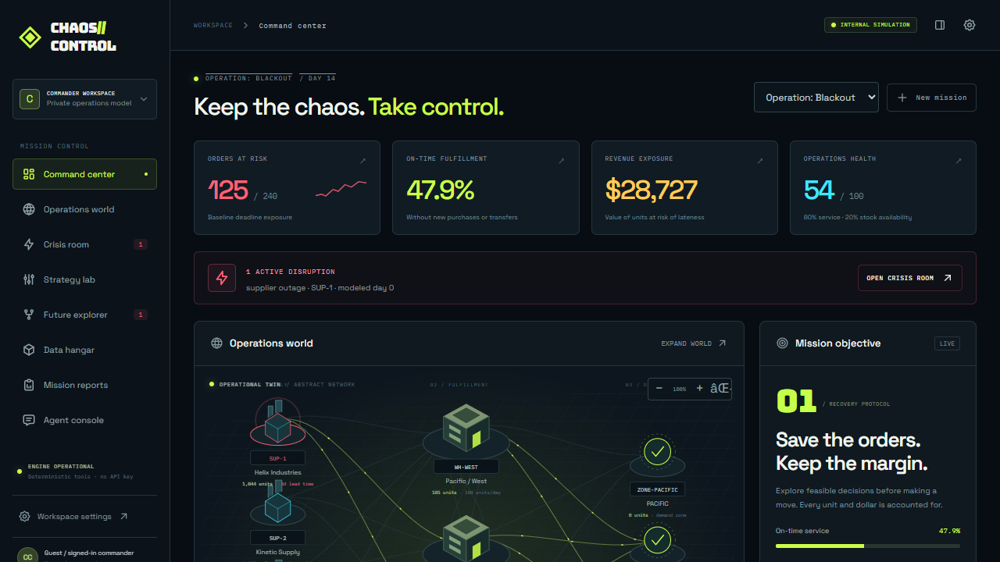

# CHAOS//CONTROL

**Your business is on fire. The future is playable.**

A playable operations digital twin built from the official **Agent-Native Chat scaffold, v0.226.0**. Import operational CSVs, inject disruptions, inspect evidence, compare feasible recovery schedules, fork isolated futures, approve a plan, execute the internal model, and audit or undo the decision.

Repository: https://github.com/eshaanvgupta/chaos-control-agent-native



## Run locally

Node.js **22.22+** and pnpm **10.29.1** are required. Node 24 is supported.

```sh
git clone https://github.com/eshaanvgupta/chaos-control-agent-native.git
cd chaos-control-agent-native
corepack enable
pnpm install --frozen-lockfile
pnpm dev
```

Open http://localhost:8080. On Windows PowerShell with script execution disabled, use `pnpm.cmd` instead of `pnpm`. No API key or separate database server is needed. PGlite persists local PostgreSQL data under ignored `data/pglite`. Enter through the landing page to create a private guest session. Guest cookies last seven days; use normal framework sign-in for durable account identity.

## A complete decision workflow

1. Start **Operation: Blackout**, **The Demand Tsunami**, or **Cascade Failure**. The synthetic seed has three warehouses, four suppliers, eighteen SKUs and 240 order lines.
2. Inject the mission incident or configure an incident in Crisis Room. Supplier delay, demand, warehouse, lane, stock, priority and cost incidents change actual model records.
3. Inspect warehouses, suppliers and demand zones in the pan/zoom network. It is an abstract network, not a geographic map.
4. Compute **ECONOMY**, **BALANCED**, and **RESCUE** plans. Adjust budget, horizon, purchase permission and priority weight. Inspect/download exact allocations and assumptions.
5. Fork a future with different incident assumptions. Parent and child snapshots remain isolated. Branch plans can be approved and committed against the parent model revision.
6. A human reviews and approves one exact stored plan. The agent cannot approve its own work. Execute separately to advance the **internal simulated clock**, update stock/order accounting and record the result.
7. Inspect the mission report, export JSON or spreadsheet-safe CSV, undo the last model change, or replay a historical event into a new branch.

**Execution sends no real purchases, shipments, payments or external business changes.** This is operations decision support with an executable internal simulation.

## Agent and no-key operation

The UI and agent invoke the same real `defineAction()` actions with Zod schemas. PostgreSQL/PGlite through Drizzle is the shared source of truth. The original Agent-Native chat sidebar, model setup, authentication, application state and action transports remain integrated.

Use **Workspace settings → Model** to connect Builder.io if available to your account. Free-credit availability and limits belong to Builder; the app does not assume unlimited free AI. Alternatively run a local tool-capable Ollama model and select the framework's Ollama provider. See [AI setup](docs/AI.md).

Without a provider, numerical planning, risk evidence, visualization, imports, branching, approval, execution and reports remain functional. These features are explicitly labeled deterministic tools. Model-backed conversation requires a working provider connection; it is never replaced with fabricated chat responses.

SENTINEL, TACTICIAN and ORACLE are specialist workflows over those tools, not three continuously running paid agents. The agent has an allowlisted action surface, raw database tools are disabled, and approval is enforced by the server.

## Data and calculations

The Data Hangar accepts mapped CSVs for products, warehouses, inventory, supplier capabilities, routes and order lines. Download working templates in the UI. Preview all tables and validate before creating a new private workspace. Missing references, duplicates, negative quantities, malformed numbers, capacity violations and oversized input are rejected. Defaults are disclosed: USD, integer cents, discrete units, day zero, seed 42 and no historical fulfillment. One CSV order row is one SKU order line; split multi-SKU baskets into unique line IDs.

The allocator is a deterministic, feasible greedy heuristic with daily lane/warehouse reservations, stock conservation, supplier availability, lead times, storage and budget constraints. **It does not prove global optimality.** Revenue exposure is sale value of units that cannot arrive by deadline. Health is 80% on-time order-line service plus 20% SKU stock availability. See [optimization](docs/OPTIMIZATION.md).

## Verification

```sh
pnpm test
pnpm typecheck
pnpm agent-native:doctor
pnpm build
```

With the development server running:

```sh
pnpm test:e2e
```

The checked-in Playwright configuration uses installed Windows Chrome when available; otherwise install the bundled browser with `pnpm exec playwright install chromium`. Browser tests create private guest workspaces, exercise recovery and imports, and test approval/access rejection at the actual HTTP action boundary. Results and limitations are recorded in [verification](docs/VERIFICATION.md).

## Deployment and submission

`pnpm build` produces the framework's deployable server and client output. Hosted deployments require persistent PostgreSQL and a stable auth secret; local PGlite is not a production database. See [deployment](docs/DEPLOYMENT.md), the [Dockerfile](Dockerfile), and [.env.example](.env.example). No production database has been provisioned by this source repository.

The [hackathon package](docs/HACKATHON.md) contains submission copy, technical evidence, attribution and a shot-by-shot two-minute Builder Clips script. A real public Clips recording and submission receipt are separate from publishing this repository.

## Ownership and attribution

Original application code is **not offered under an open-source license**. No license has been applied to the owner's original work. Agent-Native and other dependencies retain their respective licenses. See [third-party notices](THIRD_PARTY_NOTICES.md). Synthetic sample records describe no real company or customer. No paid API, maps, image or data service is required.
