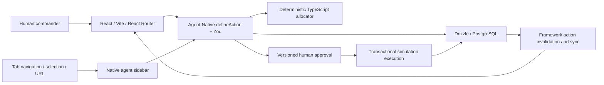

# Architecture

The app starts from the genuine official Agent-Native standalone Chat scaffold (0.226.0). Core supplies auth, actions, provider transport, agent loop, PostgreSQL/PGlite connection, application state and query synchronization. Toolkit supplies the shared agent sidebar, settings and accessible primitives. Domain operations are not implemented as separate UI APIs.

`lib/model.ts` validates operational records and cross-references; `lib/engine.ts` schedules feasible allocations; `lib/import.ts` parses mapped CSVs. `server/lib/operations.ts` owns identity, row scoping, approvals, revisions, atomic execution, branch isolation and audit records. `actions/` exposes these capabilities to the native framework.

Tables: `cc_workspaces`, `cc_branches`, `cc_plans`, `cc_events`, `cc_guest_sessions`. Workspace records store a validated, bounded relational operational snapshot in JSONB. Branches and audit events retain complete snapshots for exact counterfactuals and undo. This deliberately keeps a simulation atomic without joining mutable live records into historical branches. Domain references and numeric constraints are checked before every snapshot write; SQL additionally enforces primary keys, parent references, nonnegative revisions and plan approval/application constraints. The app does not claim a normalized ERP schema.

Every row is private to an authenticated or opaque guest-session owner. All child operations first verify the owning workspace. Mutating operational state uses `UPDATE ... WHERE revision = expected` within a transaction; a zero-row update is a conflict, never success. Approval binds to an immutable plan and base revision. Execution re-runs the plan and compares structural content before updating workspace, applied flag and audit atomically. JSONB key ordering is intentionally irrelevant.

`navigation` exposes workspace, view, selected node and branch. `view-screen` hydrates those IDs using the caller's authorization. Existing `useActionQuery`/`useActionMutation` hooks receive normal framework invalidation after UI or agent writes; the app makes no multiplayer claim and adds no high-frequency random polling.

All simulation changes stay internal. No connector to a real warehouse, commerce, carrier or purchase API is implemented.
